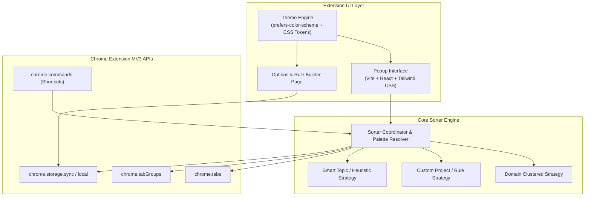

# Tabs Group Auto-Sorter — Implementation Plan

> **Vision:** "Groups open tabs by domain, project, or topic with a single click to fight tab clutter."  
> **UI Aesthetic:** Minimal, premium, light-first design with automatic system theme switching (`light` / `dark`), micro-animations, and instant responsiveness.

---

## 1. System Architecture & Tech Stack

### Technology Selection
- **Manifest:** Manifest V3 (MV3 compliant, background service worker).
- **Tooling:** Vite 6 + React 19 + TypeScript 5.8.
- **Styling:** Tailwind CSS with custom CSS variables for light/dark theme transitions, smooth cubic-bezier transitions, and glassmorphic micro-surfaces.
- **Iconography:** Lucide Icons (`lucide-react`) for clean, lightweight vector icons.
- **Storage:** `chrome.storage.sync` for user preferences and custom project rules; `chrome.storage.local` for undo history and tab state snapshots.

---

## 2. Core Sorting Modes & Intelligence

### A. Group by Domain (Deterministic & Instant)
- **Algorithm:**
  - Extracts effective second-level domains (e.g., `github.com`, `notion.so`).
  - Handles subdomains intelligently: configurable separation (e.g., `docs.google.com` vs `mail.google.com` vs grouping under `Google`).
  - Cleans group titles: Capitalizes domain brands (e.g., `youtube.com` $\rightarrow$ `YouTube`, `github.com` $\rightarrow$ `GitHub`).

### B. Group by Project (User-Defined Rule Engine)
- **Structure:**
  - Allows users to define custom projects (e.g., "Client Q3", "Design System", "Personal Dev").
  - Match rules support domain match, URL wildcard (`*jira.atlassian.com/browse/PROJ-*`), or title keywords.
  - Priority matching: First matched project claims the tab, remaining tabs fallback to domain or uncategorized group.

### C. Group by Topic (Semantic / Search Intent Heuristics)
- **Heuristic Phase (Offline, 0-latency):**
  - Search query extraction: Groups Google/Bing/DuckDuckGo searches by query theme.
  - Path/category extraction: Clusters URLs sharing common prefixes (e.g. `/docs/`, `/pricing/`, `/blog/`).
  - Title keyword frequency (TF-IDF / N-gram tokenization) for clustering related tabs across multiple sites.
- **Built-in AI Phase (Optional Progressive Enhancement):**
  - Designed to support Chrome's built-in `window.ai` / Prompt API (Gemini Nano) when available.

---

## 3. UI/UX Design Specifications

### Aesthetic Principles
- **Minimal & Premium:** Ample whitespace, subtle border glows (`ring-1 ring-border/40`), typography using system font stacks (`-apple-system, BlinkMacSystemFont, "Segoe UI", Roboto, Inter`).
- **Theme Support:**
  - Auto adapts via `@media (prefers-color-scheme: dark)` and CSS variables.
  - **Light Theme (Default/Primary):** Soft off-white backgrounds (`#FAFAFA`), crisp card surfaces (`#FFFFFF`), subtle borders (`#E5E7EB`), refined slate text hierarchy (`#0F172A`, `#475569`, `#94A3B8`).
  - **Dark Theme:** Deep obsidian zinc tones (`#09090B`), subtle midnight cards (`#18181B`), and crisp low-contrast borders.
- **Micro-Interactions:**
  - One-click hero "Organize Tabs" button with fluid hover scale and state change.
  - Live group preview drawer showing detected clusters & tab counts.
  - Group count indicators with pill tags.
  - Instant **Undo** toast ("Sorted tabs into 4 groups — [Undo]").

### Chrome Tab Group Color Palette Mapping
Chrome supports 8 distinct tab group colors:
`grey`, `blue`, `red`, `yellow`, `green`, `pink`, `purple`, `cyan`.
- Sorter implements a smart deterministic hashing or cohesive palette allocator so distinct groups receive distinguishable, harmonious colors.

---

## 4. Phase-by-Phase Roadmap Status

### Phase 1: Project Scaffolding & Build System (Completed)
- [x] Initialize Vite + TypeScript + React in the repository.
- [x] Configure `manifest.json` (MV3) with necessary permissions:
  - `"permissions": ["tabs", "tabGroups", "storage", "commands"]`.
- [x] Configure Tailwind CSS with light/dark theme variables and clean typography.
- [x] Set up icons directory and build script (`vite build` targeting `dist/`).

### Phase 2: Sorter Core Engine (Completed)
- [x] Implement `DomainGrouper`: URL parsing, TLD detection, brand dictionary, and title formatter.
- [x] Implement `ProjectGrouper`: Wildcard and regex rule evaluation against tab URL & title.
- [x] Implement `TopicGrouper`: Search intent extraction & title keyword frequency clustering.
- [x] Implement `TabGroupManager`:
  - Fetch active tabs (filtering out pinned tabs & internal URLs).
  - Execute `chrome.tabs.group` and `chrome.tabGroups.update` batching.
  - Collapse inactive groups (optional user setting).
  - Snapshot tab state for single-click "Undo" restoration.
  - Full automated unit tests covering all clustering logic (`tests/sorter.test.mjs`).

### Phase 3: Premium Popup Interface (Completed)
- [x] Header: Minimal branding, active tab count, group count badge, quick settings icon.
- [x] Hero Section: Large "Organize Now" action button with active mode indicator.
- [x] Mode Switcher: Segmented pill control (`Domain` | `Topic` | `Project`).
- [x] Quick Actions: "Ungroup All Tabs" in active window.
- [x] Live Group Preview panel: Real-time projection of target groups, tab counts, and color indicators before applying.
- [x] Feedback & Toast notification with 1-click Undo.

### Phase 4: Settings & Custom Project Rules (Completed)
- [x] Options page layout with system auto theme detector and manual override.
- [x] Grouping behavior preferences (exclude pinned tabs, collapse inactive groups, subdomain handling).
- [x] Interactive Custom Project Rules editor (add, toggle, delete rules with color tags).
- [x] Domain Exclusion Blacklist editor (add/remove domains that should never be grouped).
- [x] Backup & Restore: Export and Import configuration as `.json`.
- [x] Reset to Defaults with confirmation.

### Phase 5: Automation & Polish (Completed)
- [x] Background service worker keyboard shortcut listener for `Alt+Shift+S`.
- [x] Production bundle verification and documentation in `README.md`.
