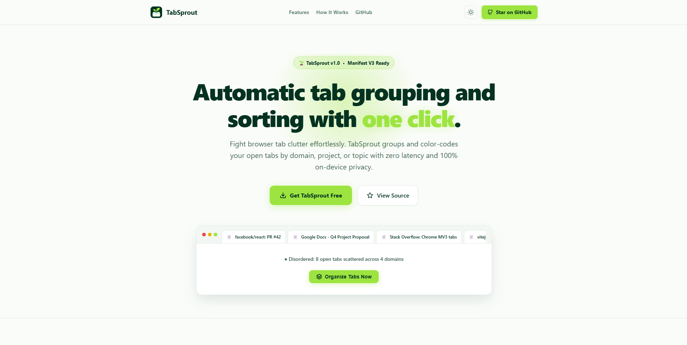

<p align="center">
  
</p>

<h1 align="center">TabSprout</h1>

<p align="center">
  <strong>Automatic tab grouping and sorting with one click.</strong><br />
  A minimal, privacy-first Manifest V3 Chrome Extension that turns tab chaos into structured clarity.
</p>

<p align="center">
  <a href="https://aniketks1.github.io/tabsprout/"></a>
  <a href="https://github.com/aniketks1/tabsprout/releases"></a>
  <a href="LICENSE"></a>
  
</p>

---

<p align="center">
  
</p>

---

## Table of Contents

- [Overview](#overview)
- [Key Features](#key-features)
- [Grouping Strategies](#grouping-strategies)
  - [1. By Domain](#1-by-domain)
  - [2. By Topic](#2-by-topic)
  - [3. By Project](#3-by-project)
- [Interactive Preview & Undo](#interactive-preview--undo)
- [Design & Theme System](#design--theme-system)
- [Installation & Setup](#installation--setup)
  - [Prerequisites](#prerequisites)
  - [Build From Source](#build-from-source)
  - [Load Unpacked in Chrome](#load-unpacked-in-chrome)
- [GitHub Pages Landing Page](#github-pages-landing-page)
- [Keyboard Shortcuts](#keyboard-shortcuts)
- [Architecture & Tech Stack](#architecture--tech-stack)
- [Privacy & Policy Compliance](#privacy--policy-compliance)
- [Testing](#testing)
- [License](#license)

---

## Overview

Modern web workflows often lead to 20, 50, or even 100+ open browser tabs spread across research, email, project trackers, and media. Navigating this clutter drains focus and productivity.

**TabSprout** solves tab overload instantly. With a single click or keyboard shortcut, TabSprout categorizes, orders, colors, and groups all open tabs in your active window using Chrome's native Tab Groups API. Built entirely with a **privacy-first architecture**, all classification happens 100% on-device with zero telemetry and zero external server calls.

---

## Key Features

- ⚡ **1-Click Tab Organization**: Tidy up dozens of scattered tabs in milliseconds.
- 🎯 **3 Intelligent Grouping Engines**: Cluster tabs by root domain, search research topic, or custom project rules.
- 👁️ **Live Interactive Preview**: Inspect target group names, tab counts, and assigned colors before executing.
- ↩️ **1-Click Undo**: Made a mistake or want your raw tabs back? Instant restoration with state snapshots.
- 🎨 **Minimal & Modern UI**: Built with React 19, Tailwind CSS, and Lucide icons.
- 🌓 **Dynamic Theme Switching**: Smooth circular reveal view transitions between Light and Dark mode with automatic OS detection.
- ⌨️ **Global Shortcut**: Press `Alt + Shift + S` to organize tabs without even opening the popup.
- 🛡️ **100% On-Device & Private**: Zero data collection, zero network calls, and fully compliant with Google Web Store policies.
- ⚙️ **Comprehensive Options**: Exclude specific domains, auto-collapse inactive groups, protect pinned tabs, and export/import configurations via JSON.

---

## Grouping Strategies

### 1. By Domain
*Groups tabs by their website or platform.*
- **Subdomain Intelligence**: Automatically extracts root domains (e.g. `docs.google.com` and `mail.google.com` group under **Google**).
- **Brand Clean Titles**: Strips `.com`, `.org`, and technical TLD suffixes, presenting clean titles like **GitHub**, **YouTube**, and **StackOverflow**.
- **User Blacklist Support**: Automatically skips browser-internal pages (`chrome://`, `edge://`) and user-excluded domains.

### 2. By Topic
*Groups tabs by context and research intent.*
- **Search Query Extraction**: Recognizes search queries from Google, Bing, DuckDuckGo, and Yahoo, grouping results by topic.
- **Natural Keyword Clustering**: Analyzes page titles, strips common noise and stop-words, and aggregates tabs exploring related topics.
- **Adaptive Fallback**: Gracefully falls back to domain clustering for unclustered singletons.

### 3. By Project
*Custom user-defined rules tailored to your workflow.*
- **Wildcard & Regex Matching**: Create rules like `*jira*`, `*github.com/my-org/*`, or `regex:^https:\/\/linear\.app`.
- **Custom Color Assignment**: Pick from Chrome’s 8 native group colors (`blue`, `purple`, `green`, `yellow`, `red`, `pink`, `cyan`, `grey`).
- **Priority-Driven**: Evaluates top-to-bottom so high-priority sprint or client rules match first.

---

## Interactive Preview & Undo

| Feature | Description |
| :--- | :--- |
| **Drawer Preview** | Toggle the live preview drawer in the popup to see exactly how many groups and tabs will be created. |
| **Pre-Sort Snapshot** | Captures the exact tab index, window ID, and pre-existing group structure before executing any grouping operation. |
| **Undo Toast** | Reverts tabs to their original ungrouped or previous state in one click. |
| **Ungroup All** | Quick action button in header to disband all groups in the active window at once. |

---

## Design & Theme System

TabSprout features a distinctive brand aesthetic inspired by fresh growth and minimalism:

- **Sprout Green (`#9de440`)**: The primary brand accent used for hero CTAs, active toggles, and focus rings.
- **Light Theme**: Soft crisp tab white (`#fafcf9`) canvas with pure white (`#ffffff`) cards and dark forest green typography (`#033220`).
- **Dark Theme**: Deep obsidian slate (`#0b0f14`) canvas with elevated cards (`#131922`), subtle borders (`#1e2633`), and high-contrast text (`#fafcf9`).
- **Smooth 60fps View Transitions**: Supports the native `document.startViewTransition()` API with circular clip-path reveals originating from click coordinates.

---

## Installation & Setup

### Prerequisites
- [Node.js](https://nodejs.org/) (v18.0.0 or higher, tested on v22)
- [npm](https://www.npmjs.com/) (v9.0.0 or higher)
- Google Chrome, Brave, Edge, or any Chromium browser with Tab Groups support

### Build From Source

1. **Clone the repository**:
   ```bash
   git clone https://github.com/aniketks1/tabsprout.git
   cd tabsprout
   ```

2. **Install dependencies**:
   ```bash
   npm install
   ```

3. **Run unit tests**:
   ```bash
   npm test
   ```

4. **Build the extension**:
   ```bash
   npm run build
   ```
   The compiled, production-ready extension will be output to the `dist/` directory.

### Load Unpacked in Chrome

1. Open your browser and navigate to `chrome://extensions`.
2. Enable **Developer mode** in the top-right corner.
3. Click the **Load unpacked** button.
4. Select the `dist/` folder inside the `tabsprout` directory.
5. Click the puzzle icon in Chrome’s toolbar and pin **TabSprout** for quick access.

---

## GitHub Pages Landing Page

A dedicated, animated, responsive landing page is included in the `/docs` directory. It uses vanilla HTML5, CSS3, and JavaScript with zero external runtime dependencies.

### Deploying the Landing Page:
1. Navigate to your repository settings on GitHub: **Settings** > **Pages**.
2. Under **Build and deployment** > **Source**, select **Deploy from a branch**.
3. Choose branch `main` and folder `/docs`.
4. Click **Save**. Your site will be published at:
   ```
   https://aniketks1.github.io/tabsprout/
   ```

---

## Keyboard Shortcuts

| Shortcut | Description | Scope |
| :--- | :--- | :--- |
| `Alt + Shift + S` | Organizes open tabs in the active window immediately using your default strategy | Global (In-Browser) |

> *Tip: You can customize or rebind this shortcut at any time by visiting `chrome://extensions/shortcuts`.*

---

## Architecture & Tech Stack

```
TabSprout/
├── docs/                   # Landing page for GitHub Pages (HTML5, CSS3, JS)
│   ├── icons/              # Responsive favicon & web icons
│   └── index.html          # Interactive landing page with live tab simulator
├── design/                 # Master branding assets & high-res artwork
│   ├── home.png            # Landing page preview screenshot
│   ├── new-icon.png        # Master icon
│   └── new-transparent-icon.png
├── public/                 # Chrome extension static assets
│   ├── icons/              # Extension icons (16, 32, 48, 128 px)
│   └── manifest.json       # Chrome Manifest V3 declaration
├── src/
│   ├── background/         # Service worker handling commands & shortcuts
│   ├── core/               # Core sorting & clustering algorithms
│   │   ├── colors.ts       # Chrome group color balancer
│   │   ├── domainGrouper.ts # TLD & subdomain grouping engine
│   │   ├── projectGrouper.ts# Wildcard & regex rule matcher
│   │   ├── tabManager.ts   # Chrome Tabs API orchestrator & undo manager
│   │   └── topicGrouper.ts # Search query & keyword frequency engine
│   ├── options/            # Full-page settings & rule builder UI
│   ├── popup/              # Extension popup with live preview drawer
│   ├── styles/             # Global CSS variables & View Transition styles
│   ├── types/              # Strict TypeScript interfaces
│   └── utils/              # Chrome storage helpers & theme controller
├── tests/                  # Automated unit test suite (Node test runner)
├── PRIVACY_POLICY.md       # Privacy documentation for Chrome Web Store
└── STORE_SUBMISSION.md     # Store listing metadata & permission justifications
```

- **Frontend**: React 19, TypeScript 5.8, Tailwind CSS, Lucide Icons
- **Bundler**: Vite 6
- **Extension Architecture**: Chrome Manifest V3
- **Test Runner**: Node.js Native Test Runner (`--experimental-strip-types`)

---

## Privacy & Policy Compliance

TabSprout is designed in strict compliance with the **Google Chrome Web Store Developer Program Policies**:

- **No Remote Code**: Does not execute `eval()`, inject external scripts, or load remote libraries.
- **Minimal Permissions**: Requests only `tabs`, `tabGroups`, and `storage`.
- **100% On-Device**: URLs, titles, and rules never leave your machine.
- **Zero Analytics / Telemetry**: No trackers, ads, cookies, or logging.

Read the complete [Privacy Policy](PRIVACY_POLICY.md) for details.

---

## Testing

TabSprout includes comprehensive automated unit tests covering domain parsing, keyword extraction, regex handling, and color assignment:

```bash
npm test
```

```
✔ Domain Grouper: extracts root domain and handles subdomains
✔ Domain Grouper: formats brand titles and handles fallback capitalization
✔ Domain Grouper: excludes internal browser URLs and user exclusions
✔ Project Grouper: pattern matching with wildcards and regex
✔ Project Grouper: matches tab to priority rule
✔ Topic Grouper: extracts search queries from engines
✔ Topic Grouper: extracts keywords and removes stop words and brand titles
✔ Topic Grouper: clusters tabs by shared search intent and keywords
✔ Color Palette: produces valid Chrome group colors

# tests 9 | pass 9 | fail 0
```

---

## License

This project is licensed under the [MIT License](LICENSE) — free to use, modify, and distribute.
